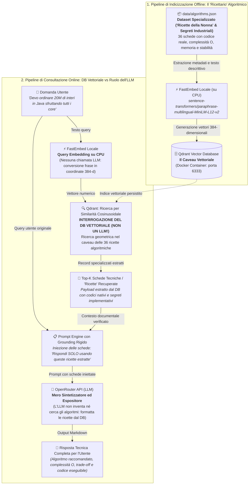

# 🤖 AppAgentica — Consulente RAG per Algoritmi di Ordinamento

[](https://www.python.org/)
[](https://qdrant.tech/)
[-green)](https://github.com/qdrant/fastembed)
[-purple)](https://openrouter.ai/)
[](https://www.docker.com/)

**AppAgentica** è un assistente intelligente basato su architettura **RAG (Retrieval-Augmented Generation)** per sviluppatori e ingegneri del software. Il sistema non si affida alla memoria generica o non verificata di un LLM: analizza i requisiti del tuo caso d'uso (linguaggio target, volume dei dati, vincoli di memoria, stabilità, parallelismo multi-core) e interroga direttamente una **banca dati vettoriale specialistica** che custodisce un vero e proprio "ricettario" di segreti industriali, benchmark prestazionali e schede tecniche verificate.

Il catalogo include **36 schede tecniche specializzate** (le "ricette" algoritmiche proprietarie con codice idiomatico pronto all'uso e complessità asintotiche matematicamente verificate) per **Python**, **Java**, **C++**, **JavaScript / TypeScript**, **C#**, **Go**, **Rust** e implementazioni classiche avanzate (Timsort, Quicksort, Mergesort, Heapsort, Radix Sort, Counting Sort, IntroSort, Dual-Pivot Quicksort parallelo, pdqsort, ecc.).

---

## 🏗️ Architettura del Sistema



> [!IMPORTANT]
> ### 🛑 Chiarimento Cruciale: Il DB Vettoriale NON è un LLM (e dove risiedono i "Segreti Industriali")
> Un equivoco comune è ritenere che, dopo aver calcolato l'embedding della query, il sistema vada a interrogare un LLM per farsi dare la risposta. **In questa architettura non è così:**
> 
> 1. **L'Embedding (`FastEmbed`) non interroga alcun LLM**: È una procedura matematica locale (eseguita su CPU) che converte le parole dell'utente in un punto geometrico (vettore denso a 384 numeri float). Non contatta nessun servizio esterno e ha zero costi.
> 2. **L'interrogazione avviene DIRETTAMENTE su Qdrant (Database Vettoriale)**: Qdrant non genera frasi e non possiede intelligenza generativa; è un motore di ricerca vettoriale ad altissime prestazioni. Cerca all'interno del proprio indice quale delle nostre 36 "ricette" algoritmiche ha il vettore più vicino a quello della domanda (tramite _Cosine Similarity_).
> 3. **Le "Ricette della Nonna" e i "Segreti Industriali" risiedono nel DB Vettoriale, NON nella memoria dell'LLM**: Il payload di Qdrant contiene il dataset specialistico (`algorithms.json`): le complessità asintotiche reali, le garanzie di stabilità, il consumo esatto di memoria, i benchmark e i trucchi del mestiere (es. il parallelismo con `ForkJoinPool` di `Arrays.parallelSort` in Java, le sequenze run adattive di Timsort in Python, o il pattern-defeating quicksort in Rust) che un LLM generico ignorerebbe o allucinerebbe.
> 4. **L'LLM interviene SOLO alla fine come semplice "Oratore / Sintetizzatore"**: L'LLM riceve la domanda assieme alle schede tecniche estratte da Qdrant e ha il vincolo di attenersi **esclusivamente** a quel contesto. L'LLM non "cerca" nel suo addestramento generale né inventa soluzioni: legge la ricetta estratta dal database vettoriale e la espone all'utente in formato didattico ed eseguibile.

### Perché questa architettura?
- **Zero allucinazioni e conformità ai segreti industriali**: L'LLM è vincolato dal prompt (`SYSTEM_PROMPT`) a non inventare algoritmi o complessità non presenti nelle schede estratte da Qdrant. Se una ricetta non esiste nel database, il modello lo dichiara esplicitamente.
- **Zero costi di embedding**: Gli embedding vengono calcolati al 100% in locale sulla CPU tramite FastEmbed, senza consumare quote API o crediti cloud.
- **Supporto multilingua nativo**: Il modello vettoriale MiniLM multilingue mappa concetti equivalenti scritti in italiano, inglese o pseudocodice nello stesso spazio semantico.

---

## 📁 Struttura del Progetto

Il progetto è strutturato secondo i moderni standard Python:

```text
AppAgentica/
├── data/
│   └── algorithms.json          # Catalogo strutturato di 36 schede tecniche degli algoritmi
├── docs/
│   └── algoritmi_ordinamento.txt # Note di approfondimento teorico e appunti storici
├── notebooks/
│   └── appagentica.ipynb        # Jupyter Notebook didattico e interattivo step-by-step
├── src/
│   └── appagentica/             # Package applicativo modulare
│       ├── __init__.py          # Export delle API pubbliche e versione
│       ├── config.py            # Gestione configurazione e caricamento variabili d'ambiente
│       ├── embeddings.py        # Generazione vettori su CPU con FastEmbed (singleton cache)
│       ├── ingest.py            # Pipeline di lettura dataset e indicizzazione in Qdrant
│       └── rag.py               # Motore di recupero semantico e consultazione LLM
├── tests/
│   ├── __init__.py
│   ├── test_config.py           # Test di caricamento parametri e percorsi
│   ├── test_dataset.py          # Validazione formale dello schema e integrità del JSON
│   └── test_rag.py              # Test della formattazione del prompt e retrieval
├── .env.example                 # Modello per le variabili d'ambiente
├── .gitignore                   # Regole per escludere venv, cache e credenziali
├── app.py                       # Entry point CLI per avviare la chat interattiva
├── docker-compose.yml           # Configurazione del container Qdrant con volume persistente
├── ingest.py                    # Entry point CLI per indicizzare il dataset
├── pyproject.toml               # Configurazione standard del pacchetto Python (PEP 621)
├── README.md                    # Questa documentazione completa
└── requirements.txt             # Dipendenze Python del progetto
```

---

## ⚙️ Prerequisiti

1. **Python 3.10 o successivo** installato nel sistema.
2. **Docker Desktop** (con Docker Compose attivo).
3. **Account e API Key gratuita su OpenRouter**:
   - Registrati su [OpenRouter](https://openrouter.ai/).
   - Genera una chiave API dalla sezione [Keys](https://openrouter.ai/keys) (ha prefisso `sk-or-v1-...`).
   - Il modello predefinito `openrouter/free` instrada verso i migliori modelli LLM gratuiti disponibili sul momento.

---

## 🚀 Guida Rapida all'Installazione

### 1. Clonazione e configurazione ambiente virtuale

Apri **PowerShell** (Windows) o il terminale:

```powershell
cd C:\projects\AppAgentica

# Creazione dell'ambiente virtuale
python -m venv .venv

# Attivazione dell'ambiente virtuale (Windows PowerShell)
.venv\Scripts\Activate.ps1

# (Su Linux/macOS usare: source .venv/bin/activate)

# Aggiornamento di pip e installazione delle dipendenze
python -m pip install --upgrade pip
pip install -r requirements.txt
```

### 2. Configurazione delle variabili d'ambiente

Crea il file `.env` a partire dal template fornito:

```powershell
Copy-Item .env.example .env
```

Modifica `.env` inserendo la tua chiave OpenRouter:

```ini
# Inserisci la chiave generata su https://openrouter.ai/keys
OPENROUTER_API_KEY=sk-or-v1-latuachiavequi...

# Parametri Qdrant (predefiniti per Docker locale)
QDRANT_URL=http://localhost:6333
COLLECTION_NAME=sorting_algorithms

# Modello di embedding locale (calcolato via FastEmbed su CPU)
EMBEDDING_MODEL=sentence-transformers/paraphrase-multilingual-MiniLM-L12-v2

# Modello LLM per la chat su OpenRouter
CHAT_MODEL=openrouter/free
```

---

## 🏃 Avvio del Servizio

### Passo 1: Avvia il Database Vettoriale Qdrant

Avvia il container Docker in background:

```powershell
docker compose up -d
```

> **Verifica:** Apri il browser all'indirizzo [http://localhost:6333/dashboard](http://localhost:6333/dashboard) per accedere alla Web UI di Qdrant.

### Passo 2: Indicizza il Catalogo degli Algoritmi

Esegui lo script di indicizzazione:

```powershell
python ingest.py
```

*Al primo avvio, FastEmbed scaricherà automaticamente il modello multilingue (circa 400 MB in cache locale). Le 36 schede tecniche verranno incorporate e salvate su Qdrant nel volume persistente `qdrant_storage`.*

### Passo 3: Avvia l'Assistente Interattivo (CLI)

Lancia l'applicazione CLI:

```powershell
python app.py
```

Digita le tue richieste in linguaggio naturale:
```text
Cosa vuoi ordinare? > Devo trovare i 5 valori maggiori in una lista enorme in Python senza ordinare tutto
```

Digita `esci` o `quit` per chiudere la sessione.

---

## 📓 Utilizzo con Jupyter Lab / Notebook

Per sperimentare interattivamente passo-passo, il progetto include un notebook didattico:

```powershell
jupyter lab
```

Apri [`notebooks/appagentica.ipynb`](file:///C:/projects/AppAgentica/notebooks/appagentica.ipynb) o [`appagentica.ipynb`](file:///C:/projects/AppAgentica/appagentica.ipynb). Il notebook ti guida attraverso:
1. Caricamento del dataset JSON e statistiche per linguaggio.
2. Generazione degli embedding vettoriali.
3. Caricamento e interrogazione dei punti in Qdrant.
4. Test di ricerca semantica (cosine similarity scores).
5. Esecuzione di query RAG complete con formattazione Rich/Markdown.

---

## 💡 Esempi di Query Supportate

| Caso d'Uso | Esempio di Domanda da fare all'agente | Algoritmo/Funzione Raccomandata |
| :--- | :--- | :--- |
| **Java Multi-core** | *"Devo ordinare 20 milioni di interi in Java sfruttando tutte le CPU"* | `Arrays.parallelSort()` (Dual-Pivot Quicksort parallelo con ForkJoin) |
| **Python Top-K** | *"Mi servono solo i 10 elementi più grandi di un log enorme in Python"* | `heapq.nlargest()` (Selezione parziale con Min-Heap $O(n \log k)$) |
| **C++ Stabilità** | *"In C++ voglio mantenere l'ordine relativo degli elementi con la stessa chiave"* | `std::stable_sort()` (Merge Sort con memoria ausiliaria) |
| **C++ Parziale** | *"In C++ voglio ordinare in memoria solo i primi 50 elementi"* | `std::partial_sort()` (Heapsort parziale in-place) |
| **Ordinamento Esterno** | *"Devo fondere 5 file già ordinati che insieme non entrano in RAM"* | `heapq.merge()` in Python o $K$-way Merge esterno |
| **Rust Performance** | *"In Rust voglio ordinare un vettore in-place alla massima velocità senza allocazioni extra"* | `slice::sort_unstable()` (Pattern-defeating Quicksort pdqsort) |
| **Dati Quasi Ordinati** | *"Ho un flusso di dati quasi completamente ordinato in Python"* | `list.sort()` (Timsort: tempo ottimo $O(n)$ sui run già ordinati) |

---

## ➕ Come Estendere il Dataset (Aggiungere "Ricette" e Segreti Industriali)

Il dataset [`data/algorithms.json`](file:///C:/projects/AppAgentica/data/algorithms.json) è il vero "caveau delle ricette" del sistema. Se possiedi algoritmi proprietari, euristiche specializzate, benchmark aziendali o "ricette segrete" di ottimizzazione, puoi aggiungerli direttamente al catalogo secondo questo schema JSON:

```json
{
  "id": 37,
  "name": "nome_funzione_o_algoritmo",
  "language": "Rust / Python / C++ / Java / ...",
  "algorithm": "Nome algoritmo base (es. IntroSort, Timsort, CustomSort)",
  "time_best": "O(n)",
  "time_avg": "O(n log n)",
  "time_worst": "O(n log n)",
  "space": "O(1)",
  "stable": false,
  "in_place": true,
  "description": "Spiegazione tecnica approfondita del funzionamento, trucchi del mestiere e segreti implementativi.",
  "use_when": "Linee guida precise e vincoli di sistema su quando preferire questa ricetta rispetto ad altre.",
  "code": "// Esempio di codice conciso, idiomatico ed eseguibile\n..."
}
```

Dopo aver salvato le nuove ricette in `data/algorithms.json`, riesegui l'indicizzazione:

```powershell
python ingest.py
```

FastEmbed calcolerà i nuovi vettori e Qdrant aggiornerà la collection. Da quel momento, le tue ricette e i tuoi segreti industriali saranno immediatamente recuperabili nelle query RAG, senza dover riaddestrare alcun modello!

---

## 🧪 Esecuzione dei Test Unitari

Il progetto include test automatici che validano l'integrità del catalogo, il caricamento delle configurazioni e il corretto funzionamento del prompt engine RAG:

```powershell
python -m unittest discover -s tests -v
```

Oppure con `pytest` (se installato):

```powershell
pytest -v
```

---

## 🛠️ Comandi Utili per Gestire Qdrant

| Operazione | Comando | Note |
| :--- | :--- | :--- |
| **Avvio** | `docker compose up -d` | Avvia il container in background |
| **Stato** | `docker compose ps` | Mostra stato e porte mappate |
| **Log** | `docker compose logs -f qdrant` | Visualizza i log in tempo reale |
| **Arresto (dati preservati)** | `docker compose down` | Il volume `qdrant_storage` resta intatto |
| **Reset totale (elimina dati)** | `docker compose down -v` | Rimuove anche il volume e tutti gli embedding |

---

## ❓ Risoluzione dei Problemi (Troubleshooting)

- **`ConnectionRefusedError: [Errno 111] Connection refused` (o porta 6333 non raggiungibile)**:
  Assicurati che Docker Desktop sia avviato e che il container sia in esecuzione con `docker compose ps`. Se la porta 6333 è occupata da un altro processo, modificala in `docker-compose.yml` e aggiorna `QDRANT_URL` nel file `.env`.
- **`RuntimeError: OPENROUTER_API_KEY mancante`**:
  Verifica che il file `.env` sia presente nella root del progetto e contenga una chiave valida nel formato `sk-or-v1-...`.
- **Errori di quota o rate limit su `openrouter/free`**:
  I modelli gratuiti possono avere picchi di carico temporanei. Se necessario, puoi impostare in `.env` qualsiasi altro modello supportato da OpenRouter (es. `meta-llama/llama-3.1-8b-instruct:free`, `google/gemini-2.0-flash-exp:free` o modelli commerciali).
